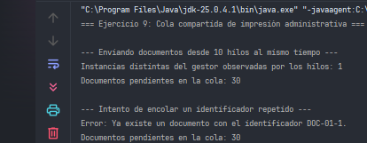
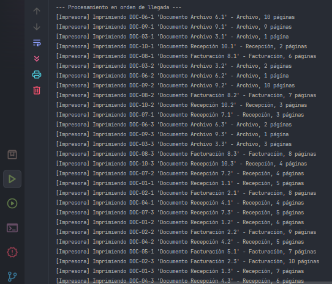
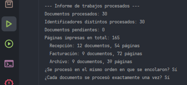

# Ejercicio 09 - Cola Compartida de Impresión Administrativa

## Descripción

Los sectores de recepción, facturación y archivo de un hospital utilizan una impresora administrativa compartida. Cuando envían documentos simultáneamente, la creación de gestores independientes provocaba pérdidas o duplicaciones de trabajos. Este ejercicio centraliza la cola en un único gestor seguro ante concurrencia.

## Objetivos

- Diferenciar la creación segura de un Singleton de la sincronización necesaria para operar sobre su estado.
- Encolar documentos con identificador único, nombre, sector y cantidad de páginas.
- Recibir solicitudes desde varios hilos y procesarlas en el orden en que fueron incorporadas.
- Emitir un informe de los trabajos procesados.
- Enviar al menos treinta documentos desde diez hilos y procesar cada uno exactamente una vez, simulando la impresión mediante mensajes.

## Implementación del patrón Singleton

La seguridad ante concurrencia tiene **dos niveles distintos**:

1. **Creación de la instancia:** variante **Initialization-on-demand holder**. La instancia vive en una clase interna estática (`Holder`); la JVM la inicializa una sola vez y de forma segura la primera vez que se llama a `getInstance()`.
2. **Operaciones sobre el estado:** los métodos `enqueue`, `processNext`, `processAll` y los de consulta son `synchronized`. El holder solo asegura que haya **una instancia**; no protege lo que ocurre dentro de ella, y sin sincronización dos hilos podrían corromper la cola.

## Propósito de la clase

- `PrintQueueManager`: es el Singleton. Mantiene la cola (FIFO), los identificadores conocidos y los trabajos procesados.
- `PrintJob`: documento a imprimir (`record` inmutable) con identificador, nombre, sector y páginas.
- `Sector`: enumeración con los sectores (recepción, facturación y archivo).
- `SectorPrintClient`: tarea (`Runnable`) que simula el hilo de un sector enviando tres documentos.
- `Main`: lanza diez hilos a la vez con un `CountDownLatch`, procesa los treinta documentos y emite el informe verificando el orden y que cada trabajo se procese una sola vez.

## Concepto clave

**Crear de forma segura una instancia no hace seguro su uso.** Un Singleton compartido por varios hilos necesita, además, que cada operación que lee y modifica su estado sea atómica. Aquí `synchronized` garantiza que cada documento se extraiga de la cola una sola vez y que el orden de llegada se conserve.

## Resultado

## Conclusión

Los diez hilos obtienen la misma instancia y los treinta documentos se encolan sin pérdidas ni duplicaciones. Se procesan en el orden de llegada y exactamente una vez cada uno, lo que muestra que la creación segura del Singleton y la sincronización de sus operaciones resuelven problemas diferentes y se necesitan ambas.
